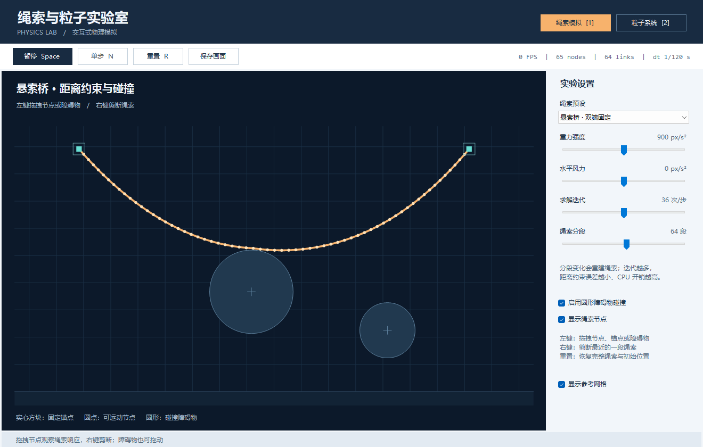
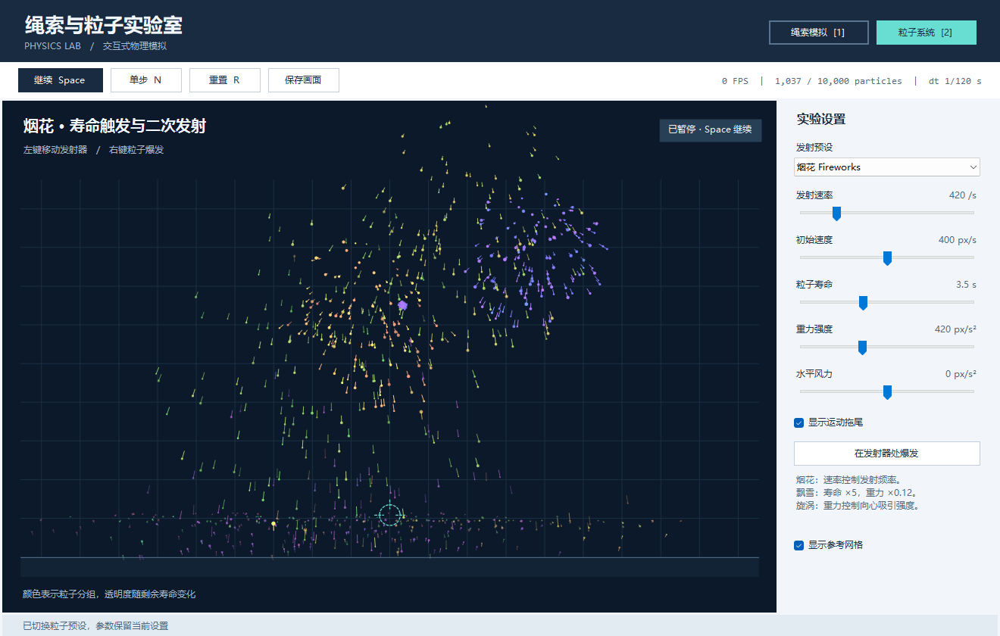

# 绳索与粒子实验室 · Physics Lab

一个可以直接运行的 **Windows C# 桌面物理模拟程序**。使用 .NET 10 / Windows Forms 实现，包含绳索模拟和粒子系统两个实验页，不依赖 Unity 编辑器。

本仓库提交的是**未压缩的完整源码工程**：`.sln`、`.csproj`、`.cs`、构建脚本和测试，既不是压缩包，也不是 `unitypackage`。

## 程序画面

以下为程序原生窗口导出的真实模拟画面，截图时为确定性检查暂停了帧计时器，因此显示 `0 FPS`；这不是运行时性能测试结果。





## 功能

### 绳索模拟

- Verlet 积分、迭代距离约束、固定锚点与阻尼。
- 悬索桥、单端摆、自由落绳三种预设。
- 左键拖拽绳索节点或固定锚点；左键拖动圆形碰撞障碍物。
- 右键剪断最近的一段绳索，剪断后两侧独立运动。
- 地面/边界约束、圆形障碍物碰撞。
- 实时调整重力、水平风力、约束迭代次数和分段数。

### 粒子系统

- 喷泉：连续发射、重力、拖尾与地面反弹。
- 烟花：火箭寿命到期后二次发射彩色火花。
- 飘雪：顶部发射、正弦扰动、风力与缓慢沉降。
- 旋涡：向心力、切向加速度与速度阻尼。
- 左键移动发射器/旋涡中心，右键在点击处产生粒子爆发。
- 调整发射速率、初速度、寿命、重力和风力。
- 容量为 10,000 的粒子池，死亡粒子原位回收，避免无限增长。

### 通用操作

| 操作 | 按键 / 鼠标 |
| --- | --- |
| 暂停 / 继续 | `Space` 或按钮 |
| 暂停时单步推进 | `N`，每次 1/120 秒 |
| 重置当前实验 | `R` |
| 绳索 / 粒子页 | `1` / `2` |
| 拖拽绳索 / 移动发射器 | 鼠标左键 |
| 剪断绳索 / 粒子爆发 | 鼠标右键 |
| 保存当前模拟画面 | “保存画面”，输出 PNG |

说明：改变绳索分段数会重建绳索；切换粒子预设和重置保留当前调参值。飘雪始终从顶部发射，左键移动的位置只影响“在发射器处爆发”按钮；右键仍可直接在点击处产生雪花。飘雪实际寿命为滑块值 ×5，重力系数为 0.12，不使用拖尾，拖尾开关会明确禁用。烟花速率换算为发射频率。旋涡的“重力”滑块控制向心力强度。界面内也提供相应说明。

## 运行环境

- **成品 exe**：Windows 10/11 x64。发布版本自带 .NET 运行时，不需要安装 .NET、Visual Studio 或 Unity。
- **源码开发**：Windows + .NET 10 SDK，或带 .NET 桌面开发工作负载且支持 .NET 10 的 Visual Studio。
- 物理核心和命令行测试不依赖 Windows Forms，可以在支持 .NET 10 的其他系统运行；图形应用仅面向 Windows。
- 建议分辨率 1280×800 及以上；较小窗口可滚动右侧参数面板。

## 从源码运行

```powershell
dotnet build PhysicsLab.sln -c Release
dotnet run --project src/PhysicsLab.App -c Release
```

也可以在 Visual Studio 中打开 `PhysicsLab.sln`，将 `PhysicsLab.App` 设为启动项目。

## 构建独立 exe

在仓库根目录运行：

```powershell
powershell -ExecutionPolicy Bypass -File scripts/build.ps1 -CopyToDesktop
```

脚本先运行物理测试，再发布自包含的 Windows x64 单文件程序：

- 构建目录：`artifacts/publish/PhysicsLab.exe`
- 桌面文件：`绳索与粒子实验室.exe`

不传 `-CopyToDesktop` 则只发布到构建目录。若桌面已有同名 exe，脚本先保留带时间戳的备份再复制。首次构建需联网还原微软 .NET 运行时包；程序运行本身不联网。单文件运行时会将必要的原生运行库解压至 .NET 的临时缓存目录，这是自包含发布的正常行为。

## 验证

物理测试不需要第三方测试框架或 NuGet 测试包：

```powershell
dotnet run --project tests/PhysicsLab.Tests -c Release -- --report artifacts/core-tests.json
```

测试包含锚点保持、距离约束误差、圆形碰撞、剪断后分离、拖拽释放、极限参数稳定性、粒子发射速率、寿命回收、烟花二次发射、地面反弹、容量上限和确定性重置等。

Windows 图形界面集成检查：

```powershell
powershell -ExecutionPolicy Bypass -File scripts/verify.ps1
```

该命令需要已解锁的交互式 Windows 桌面，会短暂打开窗口，操作真实控件事件并保存各预设和紧凑尺寸的画面到 `artifacts/ui/`。图形界面检查不是 CI 的无头测试。已有成品 exe 可直接检查：

```powershell
& '.\artifacts\publish\PhysicsLab.exe' --verify-ui "$PWD\artifacts\published-ui"
```

## 工程结构

```text
PhysicsLab.sln
src/
  PhysicsLab.Core/        # 无界面的物理核心
    RopeSimulation.cs
    ParticleSimulation.cs
  PhysicsLab.App/         # Windows Forms 窗口、绘制和交互
    MainForm.cs
    SimulationCanvas.cs
    Theme.cs
tests/
  PhysicsLab.Tests/       # 可直接运行的物理回归测试
scripts/
  build.ps1              # 测试、自包含发布、复制桌面
  verify.ps1             # 物理 + 图形界面检查
docs/
  ALGORITHMS.md          # 算法与实现位置
  VERIFICATION.md        # 本次验证记录及范围
.github/workflows/
  build.yml              # Windows 构建、物理测试与发布
```

`bin`、`obj`、运行时输出和构建缓存不提交到 Git。仓库中保留可编辑源码工程；可执行文件可作为 GitHub Release 的独立 `.exe` 附件提供。

## 范围

这是二维实时物理教学演示。绳索采用位置约束而非完整的弹性杆模型；不实现绳索自碰撞、复杂摩擦或三维扭转。所有物理量使用屏幕像素单位，不作为工程测量工具。由于题目未附原始参考程序，工程实现标准绳索/粒子交互，未声称与某个未提供的参考逐项相同。

## 许可证

MIT，见 `LICENSE`。
